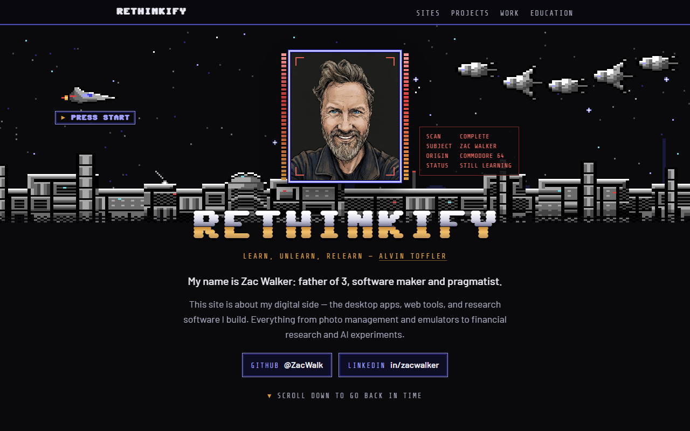

# Rethinkify Site

Personal site of Zac Walker — a single page covering his sites, open-source projects,
professional work and education. It opens on an 80s title screen, the attract mode of an
R-Type-style shooter drawn in C64 pixels, and scrolling takes you back in time to a Commodore 64
`READY.` prompt. Press start on the title screen and it is a game.

Live at [rethinkify.com](https://rethinkify.com).



## Stack

A small Flask app on Google App Engine (Python 3.13 standard environment), served by
gunicorn. Server-rendered Jinja2 and hand-written CSS. The only JavaScript is the title screen's
game, plain ES modules with no build step, which load when someone presses start; the
`Content-Security-Policy` in `web/main.py` allows scripts from this origin only.

## Layout

```
tools/
├── hero_art.py        # Draws the title-screen pixel art (dev only)
└── requirements.txt   # Its one dependency, Pillow; never deployed
web/
├── app.yaml           # App Engine config: runtime, scaling, static handlers
├── main.py            # Routes, security headers, asset versioning
├── requirements.txt
├── static/
│   ├── favicon-c64.svg
│   ├── game/          # The game: boot.js, the cabinet, the game, its art, stages and sound chip
│   ├── images/
│   └── styles.css
└── templates/
    ├── index.html     # The page
    ├── error.html     # 404 / 500, as C64 error screens
    └── sitemap.xml
```

## Project layout

Projects are told as five short stories, one per interest (photos, AI, markets, compilers and
Win32 apps), in the spirit of [bellard.org](https://bellard.org/): plain first-person paragraphs
with the achievements linked inline, whether they are my repos or work in other projects such
as GCC and Electron. Each story has one picture, which sits beside it and keeps pace as you
read; on phones it sits above.

## The game

A sideways-scrolling shoot-'em-up in the spirit of R-Type, with every picture, stage, tune and
sound effect made by code. Its five stages run back in time like the page, from The Cloud to the
Commodore 64, each with a boss named after a bug of its era. An IBM PC, a Commodore 64 and a
ZX81 stand on the floor of every stage, and chrome endoskeletons in the style of Terminator 2
march along it. The music comes from a small SID-style sound chip running as an AudioWorklet,
which composes a tune for each stage.

Arrow keys or WASD fly, holding space fires and charges the beam, letting go fires it. P pauses,
M mutes, F goes full screen and Escape quits. A gamepad works, and on a touch screen you drag to
fly and let go to fire the beam.

## Routes

| Route | Purpose |
| --- | --- |
| `/` | The page |
| `/health` | `ok` (200) for uptime checks |
| `/robots.txt` | Generated, points at the sitemap |
| `/sitemap.xml` | Generated |
| `/favicon.ico` | Serves `static/favicon-c64.svg` |
| `/game/<version>/<file>.js` | The game's modules, only under the current version token |

## Developing

```powershell
.\dd.ps1 run              # http://localhost:8081
.\dd.ps1 format           # Black, on web/ and tools/
.\dd.ps1 format --check   # Black, no writes
```

`run` uses `.venv` if present; otherwise create one and
`pip install -r web/requirements.txt`.

The title screen's pixel art is drawn by `tools/hero_art.py`. It needs Pillow, which the site
itself does not, so install it separately:

```powershell
.\.venv\Scripts\python.exe -m pip install -r tools\requirements.txt
.\.venv\Scripts\python.exe tools\hero_art.py --preview $env:TEMP
```

## Deploying

```powershell
.\dd.ps1 deploy
```

Ships to the `rethinkify` App Engine project in `europe-west1`. The target project is
hard-pinned in `dd.ps1` so a misconfigured `gcloud config` cannot deploy elsewhere.
